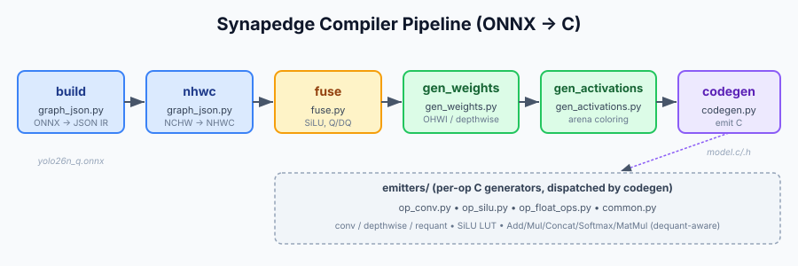
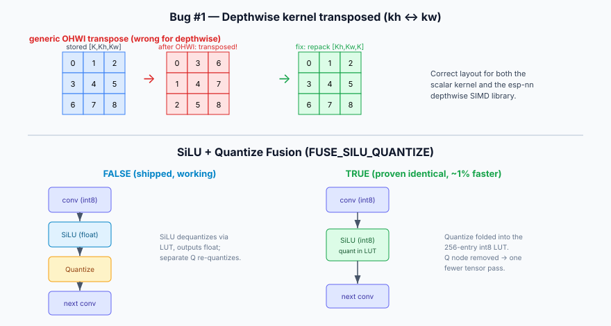
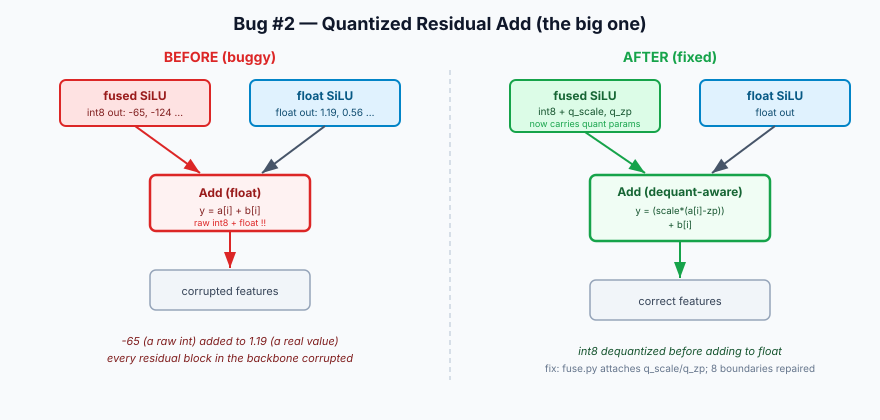
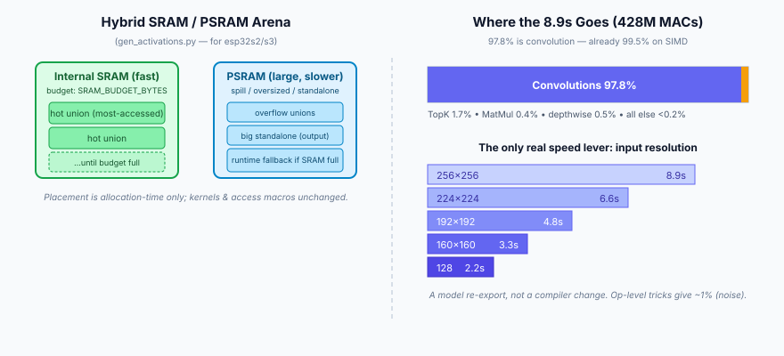

# FEMTO-ML — ONNX → C Compiler Documentation

A model-agnostic compiler that turns quantized int8 ONNX models (CNNs *and* transformer‑attention detectors) into standalone C that runs on the ESP32‑S3 (NHWC layout, esp‑nn SIMD). Validated on **YOLOv5n** and **YOLO26n**, producing correct on‑device detections verified node‑by‑node against onnxruntime.

---

## 1. Pipeline Overview

The compiler runs as an ordered set of stages, ONNX in, C out:

`build → nhwc → fuse → gen_weights → gen_activations → codegen`

Each stage operates on a shared JSON intermediate representation (IR). A change in an early stage (e.g. fusion) requires regenerating **from ONNX** — re‑running only `codegen` on an already‑transformed IR will not pick it up.

---

## 2. File‑by‑File Reference

### `graph_json.py` — build + NHWC stages
Converts ONNX to the JSON IR and rewrites tensor layouts from NCHW to NHWC.

- Rank‑aware axis remapping (only remaps axis 1→3 for 4‑D tensors, leaving lower‑rank tensors alone).
- Metadata‑only inlining: small scale/zero‑point/bias values are inlined; large weight tensors stay file‑backed.
- Flags conv weights for the weight generator: standard convs get an `ohwi` flag; **depthwise convs are flagged `depthwise`** (detected by `group>1 and weight_in_channels==1 and out_channels==group`) so they are repacked correctly instead of being run through the generic OHWI transpose.

### `fuse.py` — graph‑level fusion
Operates only on the JSON IR. Two fusions:

1. **SiLU** — collapses `Sigmoid + Mul` (and the quantized `QLinearSigmoid + QLinearMul` form) into a single `SiLU` node carrying `in_scale/in_zp` and `out_scale/out_zp`, so the emitter can build a 256‑entry lookup table.
2. **Q/DQ cancellation** — adjacent `DequantizeLinear → QuantizeLinear` with matching scale/zp is dropped.

Directive: `FUSE_SILU_QUANTIZE` (module‑level constant, not a CLI flag).
- `True` — SiLU absorbs the following `QuantizeLinear`; emits an **int8 → int8** LUT (quantize folded in, one tensor pass).
- `False` — **shipped default.** SiLU reads int8, outputs float; a separate `QuantizeLinear` requantizes. This is the original, proven‑working behaviour.

`fuse.py` also attaches `q_scale`/`q_zp` to every int8 SiLU output so downstream float ops know how to dequantize them (see Bug #2).

### `gen_weights.py` — weight emission
Emits multi‑file, 16‑byte‑aligned weight arrays.
- Standard convs: OIHW → OHWI transpose.
- **Depthwise convs**: repacked `[K,1,Kh,Kw] → [Kh,Kw,K]` (HWC), the layout both the scalar depthwise kernel and the esp‑nn depthwise SIMD library expect.

### `gen_activations.py` — arena allocation
Assigns activation tensors to memory via interval‑graph coloring (tensors whose live ranges don't overlap share a union), dramatically reducing RAM.

Adds a **hybrid SRAM/PSRAM arena** (see §4): priority unions go in fast internal SRAM under a hard budget, the rest spill to PSRAM. `--target` accepts `esp32s3`, `esp32s2`, `ansi_int8`, `ansi_float`.

### `codegen.py` — dispatcher / C emitter
Walks the IR, dispatches each node to its emitter, and writes `model.c/.h`. Targets: `esp32s3 | esp32s2 | ansi_int8 | ansi_float`, with `--simd`, `--debug`, `--dump`. Includes the esp‑nn conv and depthwise‑conv SIMD headers under `esp32s3 + simd`.

### `emitters/`
- **`op_conv.py`** — standard conv (esp‑nn SIMD + scalar fallback), depthwise conv (SIMD + scalar), and the shared TFLite integer requant helper (`_tflm_requant` / `_tflm_srdhm` / `_tflm_rounding_shift`).
- **`op_silu.py`** — SiLU LUT emitter. Emits an int8→int8 LUT when the output tensor is int8 (fused), else a float LUT. Decision is driven by the **graph's output dtype**, the source of truth.
- **`op_float_ops.py`** — Add, Sub, Mul, Concat, Split, Slice, Softmax, MatMul, Div, ReduceMax, GatherElements, Expand, Cast, Reshape/Transpose/Flatten/Unsqueeze (pass‑through). Dequant‑aware ops call `_isq`/`_deq`; non‑dequant ops call the `_assert_not_quantized` safety guard.
- **`common.py`** — shared helpers.

### `compare_fuse_modes.py` *(tool)*
Captures a `True` and a `False` device run into separate labelled files, then compares them node‑by‑node. Used to prove the fusion is numerically identical and to localize any divergence.

---

## 3. Bugs Encountered & Fixed

### Bug #1 — Depthwise kernel transposed (kh ↔ kw)

Depthwise weights `[K,Kh,Kw,1]` were flagged `ohwi` like ordinary convs, so the generic OIHW→OHWI transpose **spatially transposed the 3×3 kernel** (swapping rows and columns). Detections were roughly right but the positional‑encoding convs were subtly wrong.

**Fix:** detect depthwise in `graph_json.py` and flag it distinctly; repack explicitly to `[Kh,Kw,K]` in `gen_weights.py`; update the scalar kernel's indexing to match. Now bit‑correct, and the same layout feeds the depthwise SIMD library.

### Bug #2 — Quantized residual Add (the big one)

Revealed by a Netron view of `/model.6/m.0/m/m.0/Add`. A residual `Add` received a **fused int8 SiLU output** (values like −65) on one input and a **float** SiLU output on the other, and computed `y[i] = a[i] + b[i]` — adding **raw int8 to float without dequantizing**. Root cause: fused int8 SiLU outputs didn't carry `q_scale`/`q_zp`, so the Add emitter's existing dequant check (`_isq`) silently never fired.

**Impact:** every residual block in the backbone was corrupted (8 boundaries: model.6, 8, 9, 12, 13, 15, 16, 19). Present in *both* fusion modes — a general correctness bug, not a fusion‑only one.

**Fix:** `fuse.py` attaches `q_scale`/`q_zp` (resolved from the SiLU's `out_scale`/`out_zp`) to int8 SiLU outputs. The dequant‑aware ops (Add, Concat, Sub, Slice, Softmax, MatMul) now correctly compute `(scale·(a[i]−zp)) + b[i]`.

### Bug #3 — Negative zero‑point renders as `--`
The dequant expression `a[i]-{zp}` produced `a[i]--94` for a zp of −94 — parsed as the decrement operator on a read‑only value, a compile error.
**Fix:** render as `a[i] - (-94)` at every dequant site in `op_float_ops.py`.

### Bug #4 — Requant shift convention
`_tflm_requant` used a right shift of `31 - shift`, which zeroed every conv output → **0 detections**. The correct amount is `-shift` (the mult/shift pair encodes `M = mult · 2^(shift−31)`, so `acc·M = srdhm(acc,mult) · 2^shift`).
**Fix:** right‑shift by `-shift`, verified numerically against `acc·M`.

### Recurring process trap — stale bytecode / partial regeneration
Most false debugging cycles came from `__pycache__` serving stale `.pyc` files, or from re‑running `codegen` on an already‑fused `graph_fused.json` instead of regenerating from ONNX. Fusion/build‑stage changes require: clear `__pycache__`, delete `graph_fused.json` + `model.*`, regenerate from ONNX.

---

## 4. Features Added

### Depthwise SIMD
Wired the `esp_nn_depthwise_conv_s8_simd` library: `[Kh,Kw,K]` weight repack, `dw_conv_params_t` emission with `ch_mult=1`, routed under `--simd` with the scalar depthwise kernel as fallback. Correct, but depthwise is ~0.5% of compute, so the speed impact is negligible.

### Hybrid SRAM/PSRAM Arena

For the memory‑constrained esp32s2. Priority tensor unions (`SRAM_PRIORITY = "hot"` most‑accessed, or `"large"` biggest‑first) are placed in fast internal SRAM up to `SRAM_BUDGET_BYTES`; overflow, oversized, and standalone buffers go to PSRAM, with a runtime PSRAM fallback if an internal allocation fails. Placement is purely an allocation‑time decision — kernels and access macros are unchanged.

### SiLU + Quantize Fusion
A toggleable directive that folds the post‑SiLU `QuantizeLinear` into the SiLU's int8 LUT (quantize becomes free at runtime). Proven **numerically identical** to the unfused path (0/256 LUT mismatches, bit‑exact on device, identical on all shared nodes). Saves ~1% — shipped **off** for simplicity.

### Op‑level dequant safety guard
Ops without dequant handling (Div, ReduceMax, GatherElements, Expand, Cast) now raise a clear compile‑time error if handed a quantized int8 input, instead of silently emitting wrong code. Fires 0 times on the current model — pure future‑proofing.

---

## 5. Performance — Honest Assessment

Inference is **~8.9 s at 256×256**, and this is **inherent, not a bug**:

- Convolutions are **97.8%** of compute (428M MACs); everything else (TopK 1.7%, MatMul 0.4%, depthwise 0.5%, the rest <0.2%) is negligible.
- **99.5%** of conv MACs already run on the esp‑nn SIMD path. `428M ÷ ~50 MMAC/s ≈ 8.6 s`, matching the observed time.
- Op‑level optimizations (depthwise SIMD, SiLU fusion, arena placement) each move the total by **~1%** — measurement noise against the conv compute.

**The only meaningful speed lever is input resolution**, which is a model re‑export, not a compiler change:

| Input | Approx MACs | Approx time |
|-------|-------------|-------------|
| 256×256 | 429M | ~8.9 s |
| 224×224 | 328M | ~6.6 s |
| 192×192 | 241M | ~4.8 s |
| 160×160 | 167M | ~3.3 s |
| 128×128 | 107M | ~2.2 s |

---

## 6. Current State

- **YOLO26n** runs on ESP32‑S3 with correct detections (car, truck, people on real cluttered scenes), `FUSE_SILU_QUANTIZE = False`, all correctness bugs fixed.
- **YOLOv5n** — complete and working (CNN, esp‑nn SIMD).
- Together: a genuinely **model‑agnostic** ONNX→C compiler handling both CNNs and transformer‑attention detectors on a microcontroller.

**Open validation:** confirm the ~0.5 confidence scores are the model's true output by comparing the final `output0` / score nodes against onnxruntime on the same image. Correct classes + fixed residuals strongly suggest ~0.5 is simply what int8 YOLO26 produces at 256×256; if ORT scores higher, one more drift source remains.

---

## 7. Build Checklist (avoids the recurring traps)

1. `rmdir /s /q <repo>\emitters\__pycache__` and `<repo>\__pycache__`
2. Delete `graph_fused.json`, `model.c`, `model.cpp`, `model.h`
3. Regenerate **from ONNX** (full pipeline), with `--target esp32s3 --simd`
4. Verify before compiling, e.g. `findstr /C:"static inline int _tflm_requant" model.h`
5. For the depthwise SIMD build, add `esp_nn_depthwise_conv_s8_simd.c/.h` to the sketch
6. Flash; validate with `serial_compare.py` (device vs ORT) and/or `compare_fuse_modes.py` (True vs False)
